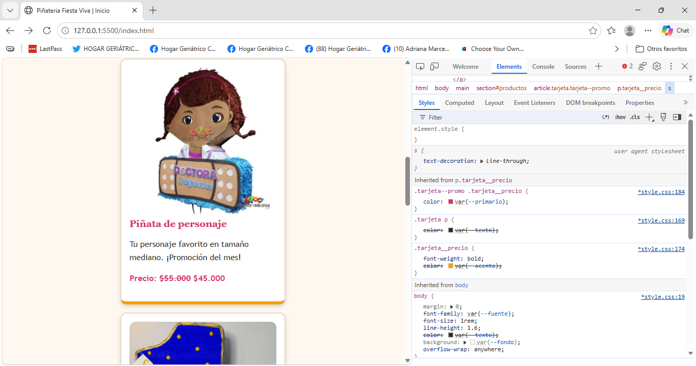
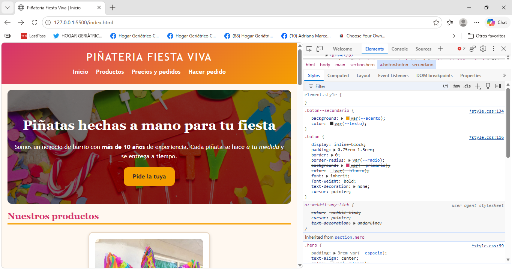
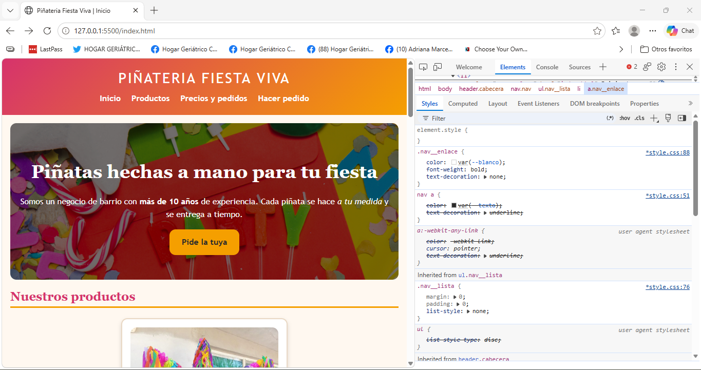
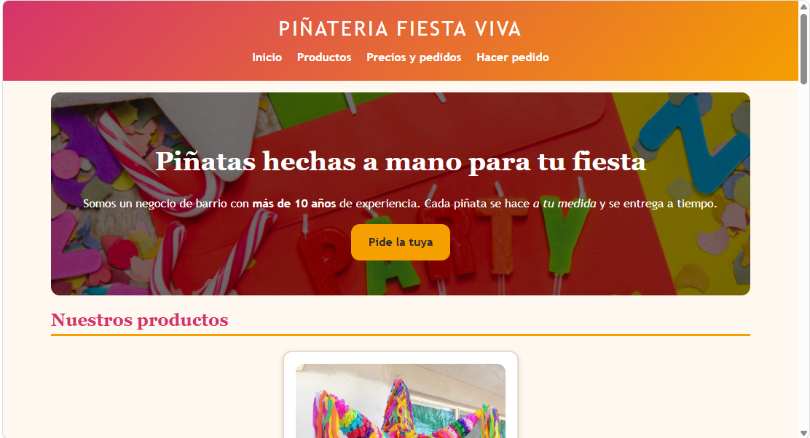
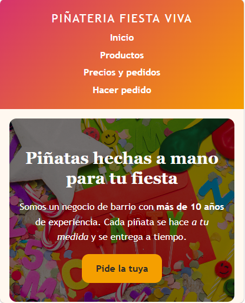
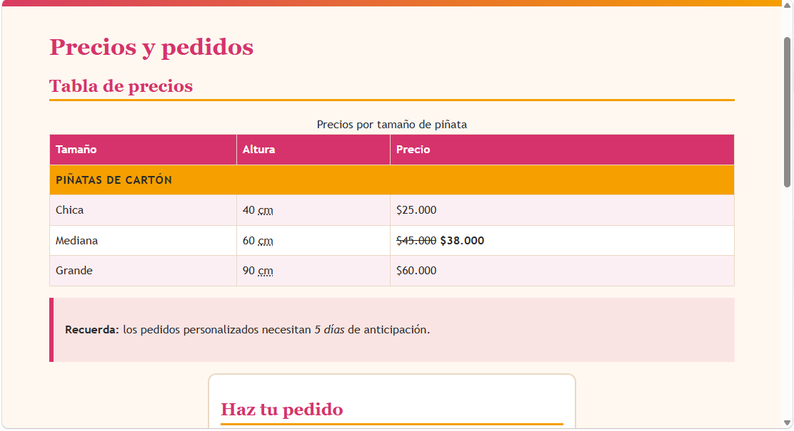
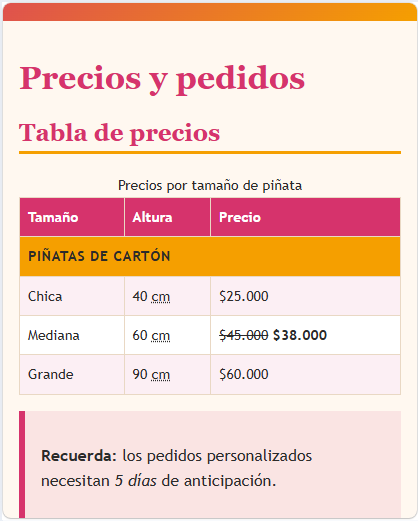

# Piñatería Fiesta Viva

## 1. El proyecto
Sitio web de una piñatería de barrio (negocio inventado). Está pensado para las familias que organizan cumpleaños y hoy piden solo por WhatsApp. El cliente necesita mostrar sus productos y precios, indicar horarios y ubicación, y recibir pedidos desde el celular.

## 2. Estructura
```
pinateria/
├── index.html
├── pedidos.html
├── README.md
├── css/styles.css
├── images/
└── capturas/
```
- `header` + `nav`: marca y menú compartidos por las dos páginas.
- `main`: contenido único de cada página.
- `section`: cada bloque temático (productos, información, opiniones, ubicación, precios, formulario).
- `article`: cada tarjeta de producto, porque tiene sentido por sí sola.
- `aside`: el aviso de anticipación en `pedidos.html`, contenido complementario.
- `footer`: contacto y enlace externo.

## 3. Sistema visual
Variables en `:root`: `--primario` (#d6336c, rosa de piñata), `--acento` (#f59f00, amarillo que resalta), `--texto` (#2b2b2b, buen contraste sobre fondo claro), `--fondo` (#fff8f0, crema cálido). Fuentes: `--fuente` (Trebuchet, legible) y `--fuente-titulo` (Georgia). Espacios: `--espacio` (1rem) y `--radio` (0.75rem). Usé pocos colores para que las fotos aporten la alegría.

## 4. Especificidad
### Conflicto 1: el precio de la tarjeta en promoción
- `.tarjeta p` → (0,1,1) `color: var(--texto)`
- `.tarjeta__precio` → (0,1,0) `color: var(--acento)`
- `.tarjeta--promo .tarjeta__precio` → (0,2,0) `color: var(--primario)`

Gana `.tarjeta--promo .tarjeta__precio` (2 clases). Al principio solo tenía `.tarjeta__precio` y perdía contra `.tarjeta p`.


### Conflicto 2: el botón secundario (empate, se resuelve por orden)
- `.boton` → (0,1,0) `background: var(--primario)`
- `.boton--secundario` → (0,1,0) `background: var(--acento)`

Empatan; gana `.boton--secundario` porque está después en el archivo.


### Conflicto 3: el color de los enlaces del menú
- `nav a` → (0,0,2) `color: var(--texto)`
- `.nav__enlace` → (0,1,0) `color: var(--blanco)`

Gana `.nav__enlace` aunque `nav a` tiene más etiquetas: una clase pesa más que cualquier cantidad de etiquetas.


## 5. Herencia
- Se hereda: `color` y `font-family`, definidos en `body`; los párrafos y listas los toman sin reescribirlos.
- No se hereda: `border`. En `.tarjeta` el borde no pasa a la imagen ni a los textos de dentro.

## 6. Modelo de cajas
Ancho total de `.tarjeta` (máximo): contenido 18rem (288px) + padding 2 × 1rem (32px) + borde 2 × 2px (4px) = **324px**, que cabe en 360px.

## 7. Selectores
`.tabla tbody tr:nth-child(even)` cuenta los `tr` hermanos dentro de `tbody`: 1) fila del grupo (con `colspan`), 2) Chica, 3) Mediana, 4) Grande. Se aplica a las filas 2 y 4 (Chica y Grande). La fila del grupo cuenta aunque tenga otro contenido, porque se cuentan todos los hermanos, no solo los de cierto tipo de celda.

## 8. Responsive
Con `@media (max-width: 480px)` el menú pasa de estar en línea a apilarse (`display: block` en los `li`), se reducen los títulos y el padding del banner, y se achica la letra de la tabla, para que nada se salga a 360px.

## 9. Problemas y soluciones
1. *(Escribe aquí un problema real tuyo: qué pasaba, por qué y cómo lo arreglaste.)*
2. *(Escribe aquí un segundo problema real tuyo.)*

## 10. Capturas
| Escritorio | 360 px |
|---|---|
|  |  |
|  |  |


